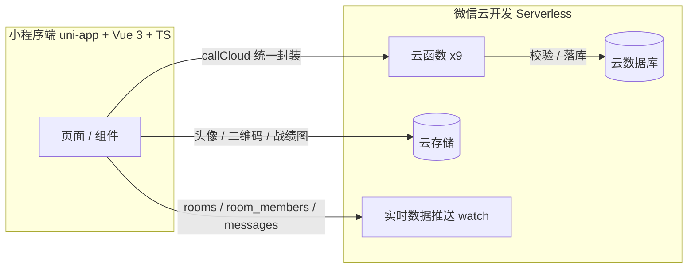

<div align="center">

# 🃏 打牌好友记账

**打完牌不算账？让 AI 都看不下去的记账体验。**

开一间房 → 扫码进房 → 点头像转账 → 一键结算，自动算出「谁给谁转多少」的最少转账方案。

[](https://vuejs.org)
[](https://www.typescriptlang.org)
[](https://uniapp.dcloud.net.cn)
[](https://vitejs.dev)
[](https://developers.weixin.qq.com/miniprogram/dev/wxcloud/basis/getting-started.html)
[](https://nodejs.org)

*纯积分记账 · 无任何资金支付 · 仅供好友娱乐对账*

</div>

---

## ✨ 功能一览

| 模块 | 能力 |
| --- | --- |
| 🏠 **首页** | 进行中牌局卡片、创建房间、扫码进房、输房号进房、头像昵称填写（官方能力） |
| 🚪 **房间** | 4 位房号 + 普通二维码扫码进房、成员实时在线、点其他成员头像即可记账、实时消息流（系统/转账动态）、快捷语句面板 |
| 🧮 **结算** | 仅房主确认，服务端贪心算法自动算出**最少转账笔数**，一键出转账方案 |
| 📊 **战绩** | 历史对局归档、累计输赢一目了然 |
| 🖼️ **战绩图** | Canvas 绘制结算分享图（净额排名 + 首页小程序码），保存相册 / 转发 |
| 📜 **流水** | 单房转账明细逐笔可查，append-only 不可篡改 |
| 📖 **手册 & 客服** | 小程序内使用手册、联系客服 |

## 🏗️ 技术架构



**核心约定：账本 append-only。** 每笔记账是一条 `{from: -x, to: +x}` 的转账流水，不支持撤销——转错了反向再转一次，历史永不篡改。净额由流水实时汇总，最少转账方案由服务端结算时贪心计算。

## 🛡️ 上线级设计细节

- **并发安全**：进房占座、结算锁、转账防重全部基于**条件更新**（`where status + memberCount` 原子操作），连点/并发进房不超卖
- **幂等结算**：结算落库可重入，中断后房主重进可续结，不产生重复账目
- **转账互斥**：结算把房间置为 `settling`，与转账的同文档条件更新天然互斥，杜绝"结算瞬间还在记账"
- **防滥用**：进房失败防爆破限流（10 次/分钟）、记账限流（20 次/分钟）、单房流水上限
- **内容安全**：昵称过 `msgSecCheck`、头像过 `imgSecCheck`（v2 接口），违规直接拦截不入库
- **数据自洁**：房间结束后消息流延迟 5 分钟惰性清理，`messages` 永不膨胀
- **断线兜底**：房间页实时监听断线自动重连（上限 5 次），权限/网络异常明确提示

## 📂 项目结构

```
├── cloudfunctions/          微信云函数（Serverless 后端）
│   ├── createRoom/          创建房间：分配 4 位房号 + 生成房间二维码
│   ├── joinRoom/            扫码/输房号进房：占座、防爆破限流
│   ├── leaveRoom/           退出房间 / 房主解散
│   ├── transfer/            记账唯一入口：服务端全量校验 + append-only 流水
│   ├── settle/              结算：贪心最少转账 + 快照落库（幂等可重入）
│   ├── getOngoingRoom/      进行中牌局查询 + 结束房间消息惰性清理
│   ├── getMyGames/          战绩聚合（aggregate 跨房间汇总）
│   ├── getRoomFlow/         单房流水明细
│   └── checkContent/        内容安全检测（昵称文本 / 头像图片）
├── src/
│   ├── apis/                云调用统一封装（callCloud 按域拆分）
│   ├── components/          通用组件
│   ├── pages/               7 个页面（首页/战绩/房间/结算/对局详情/流水/手册）
│   ├── styles/              reset + 公共 SCSS mixin
│   ├── static/              tabbar 图标 / 分享封面
│   ├── types/               全局 TS 类型
│   └── utils/               头像兜底 / Canvas 战绩图生成
├── design/                  静态设计稿（HTML，UI 改动需同步）
├── docs/                    云开发接入方案
└── AGENTS.md                AI 协作规范入口（.agents/rules/ 全套工程规范）
```

## 🚀 快速开始

> 前置：Node.js ≥ 22，微信开发者工具（开通云开发），自己的小程序 AppID 与云环境 ID
> （配置在 `src/manifest.json` 的 `mp-weixin.appid` 与 `src/App.vue` 的 `wx.cloud.init`）

```bash
# 1. 安装依赖
npm install

# 2. 本地开发（watch 编译）
npm run dev:weixin

# 3. 微信开发者工具导入 dist/dev/mp-weixin 目录即可预览

# 4. 生产构建
npm run build:weixin
# 微信开发者工具导入 dist/build/mp-weixin，上传提审
```

云函数首次部署：开发者工具左侧 `cloudfunctions/` 目录 → 逐个右键「上传并部署：云端安装依赖」。

## 🧰 工程化

- 🔍 **ESLint + Prettier + Husky**：提交时自动 lint-staged 校验
- 📐 **样式体系**：语义 class + scoped SCSS，颜色全部走 CSS 变量（`design/common.css` 对齐），红涨绿跌配色符合国内习惯
- 🤖 **Agent 协作规范**：`.agents/rules/` 内置行为规范与六份技术规范，AI 改码留痕于 `.agents/logs/`
- 🖼️ **设计稿即真相**：`design/` 下 13 份静态 HTML 稿与线上一比一对齐

## 📄 许可与声明

- 本项目为**纯积分记账工具**，不含任何支付、资金转移或博彩引导功能，仅限好友间娱乐对账
- 作者：[鹏多多](https://github.com/wp993080086)

<div align="center">
<sub>⭐ 觉得有用就点个 Star — 打牌愉快，记得结账！</sub>
</div>
